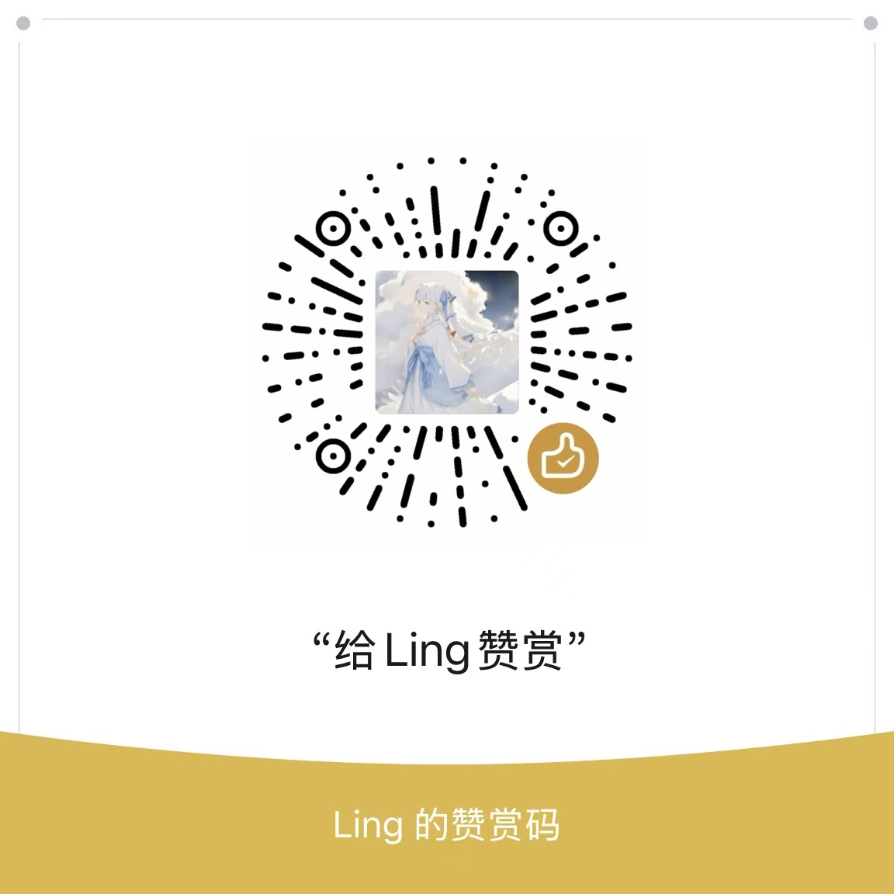

[English](README.md) | [简体中文](README_ZH.md)

# Xiaomi Power Bank Console Mirror (Qi2.2 Control)


An unofficial mirror of the Xiaomi Power Bank WebHID console, adding full **Qi2.2 on/off** control across both legacy and encrypted protocols.

- **Live Site (New)**: https://mirror-mieco.raycsec.com/
- **Live Site (Legacy)**: https://mirror-mieco.nalaniflynn.cn/
- **Architecture**: Single-file Cloudflare Worker + R2 static assets
- **Browser Requirement**: Desktop Chrome (WebHID supported)

> **Disclaimer**: This repository is not an official Xiaomi project and has no affiliation with or authorization from Xiaomi Corporation. For learning and research purposes only.

## Features

- **Native Qi2.2 Switch**: Integrated directly into the original device panel with matching UI, busy locks, and error prompts.
  - **Legacy models** (e.g., `WPB1025S`): Uses the original plaintext command.
  - **Newer models** (`WPB1026S`, `WPB1025`): Uses the encrypted protocol (`re-handshake → read battery health & cycle count → derive session key → encrypted write → read-back verification`). Success is reported only when the read-back value matches.
  - **Auto fallback**: `WPB1026S` tries the encrypted path first, `WPB1025S` tries the plaintext path first; if the first path is rejected the other one is attempted automatically.
  - **`WPB0525S`**: the hardware supports Qi2.2, but the current enable method is not adapted yet (the firmware rejects both the encrypted and the plaintext command), so no toggle is offered for this model.
- **Model Support Labels**: Categorized into three tiers — **Supported**, **Encrypted Protocol**, and **Possibly Supported (Untested)**. Untested models display a "Try Enabling (Untested)" button with a yellow notice inside the card. Legacy-exclusive models (`P25`, `AC1067`, `P15`, `PB2020`) are retained for viewing (18 models in total).
- **Activation Success Rate Statistics**: Each toggle reports one record (model, SN hash, action, result, failure detail) deduplicated by `(model, sn_hash, action)` in Cloudflare D1:
  - **Samples ≥ 5 & error rate > 30%**: Displays a yellow success-rate notice.
  - **Error rate < 10%**: Displays a green success rate with a checkmark.
  - **Samples < 5**: No badge is shown (statistics stay hidden until the sample size is meaningful).
  - Reporting failures never block the toggle action or UI.

## Directory Structure

```text
src/worker.js                  # Worker entry point (matches production deployment)
src/index.js                   # Main React application bundle (readable)
src/XiaomiPowerBankPanel.js    # Device panel: WebHID I/O, Qi2.2 control, stats UI
src/ModelData.js               # Model metadata table (with Qi2.2 capability flags)
src/ModelSupportPanel.js       # Supported models list component
src/index.css                  # Stylesheet
src/react-vendor.js            # React runtime
scripts/authored-worker.js     # Hand-maintained Worker source (build input)
scripts/build_worker.mjs       # Build script (outputs src/worker.js)
docs/CHANGELOG.md              # Detailed changelog of added features
```

## Deployment

1. Prepare a Cloudflare account with a **D1** database, an **R2** bucket (for static assets), and a **Workers Custom Domain**.
2. Configure bindings and secrets:
   - `DB`: D1 database (auto-creates tables on first request: `auth_sessions`, `used_tokens`, `cn_tokens`, `qi2_reports`).
   - `XIAOMI_MIRROR`: R2 bucket with asset key prefix `eco--usb-device-web/static/`.
   - `SECRET_KEY`, `AGREE_SECRET_KEY`: **Required secrets** for signing session and consent tokens (omitting them falls back to default values in code — do not use defaults in production).
3. Upload all static files in `src/` **except** `worker.js` to the R2 bucket under `eco--usb-device-web/static/` using their exact filenames, and deploy `src/worker.js` as the Worker module (`main_module = worker.js`).
4. Bind your Custom Domain in the Worker's **Custom Domains** settings; Cloudflare will issue the SSL certificate automatically.

> **Security Note**: Default fallback keys are kept in the repository solely so the code can run out of the box for testing. Always configure explicit Secrets and rotate them periodically in production.

## Statistics Table Schema

```sql
CREATE TABLE qi2_reports (
  model      TEXT,
  sn_hash    TEXT,   -- First 16 bytes (hex) of SHA-256(SN); plaintext SN is never stored
  action     TEXT,   -- on / off
  ok         INTEGER,
  detail     TEXT,   -- Protocol name on success, or failure reason
  created_at INTEGER,
  updated_at INTEGER,
  PRIMARY KEY (model, sn_hash, action)
);
```

Because `sn_hash` is part of the primary key, repeated operations on the same device update the existing record rather than inflating counts.

## API Endpoints

| Method | Path | Description |
| --- | --- | --- |
| `GET` | `/api/qi2-stats?model=WPB1026S` | Returns activation sample count, success count, and error rate for the model |
| `POST` | `/api/qi2-report` | Submits a toggle result (requires a valid session) |

## Sponsor

If this project has been helpful to you, feel free to buy me a coffee!

<p align="center"></p>

## Credits

- **Xiaomi Official Frontend** (`powerbank.mieco.net`) — Original source for page layout, device HID protocol, UI style, and base model data. All trademarks and copyrights belong to Xiaomi Corporation.
- **[yunhaocloud-collab/xiaomi-powerbank-console-WPB1026S](https://github.com/yunhaocloud-collab/xiaomi-powerbank-console-WPB1026S)** — Public implementation of the `WPB1026S` encrypted setup protocol (handshake, session key derivation, encrypted payload, read-back verification). The encrypted write path in this repo adapts its logic to match the original panel style.

All remaining code (mirror Worker, panel integration, and statistics) was implemented specifically for this repository without using other third-party open-source code.

Thanks to the authors above for sharing the protocol and implementation. If you are a rights holder and believe this repository contains content that should not be public, please open an issue and it will be handled promptly.

## License

[MIT License](LICENSE). Original project copyright notices are preserved above and in `LICENSE`.
