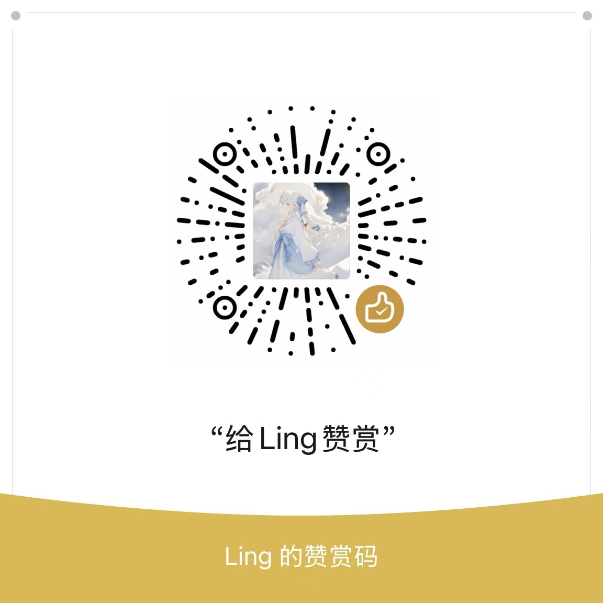

[English](README.md) | [简体中文](README_ZH.md)

# Xiaomi 移动电源控制台 · 镜像版（Qi2.2 开关）


基于小米官方移动电源详情页的可用镜像，补全了 Qi2.2 的**开启 / 关闭**能力，兼容旧版明文与新版加密协议。

- **在线站点（新）**：https://mirror-mieco.raycsec.com/
- **在线站点（旧）**：https://mirror-mieco.nalaniflynn.cn/
- **项目架构**：单文件 Cloudflare Worker + R2 静态资源
- **运行要求**：支持 WebHID 的桌面端 Chrome 浏览器

> **免责声明**：本仓库不是小米官方项目，与小米公司无任何隶属或授权关系，仅供学习与研究。

## 功能特性

- **原生 Qi2.2 开关**：直接接入原面板代码，UI、忙碌锁及错误提示均保留原样式。
  - **旧型号**（如 `WPB1025S`）：沿用原有明文设置指令。
  - **新型号**（`WPB1026S` / `WPB1025`）：使用加密设置协议（`重新握手 → 读取电池健康度与循环次数 → 派生会话密钥 → 加密写入 → 回读校验`），仅在回读结果一致时才提示成功。
  - **自动降级**：`WPB1026S` 优先走加密路径，`WPB1025S` 优先走明文路径；先尝试的方式被拒绝时会自动改用另一种方式再试一次。
  - **`WPB0525S`**：硬件层面支持 Qi2.2，但当前开启方式尚未适配（固件同时拒绝加密与明文设置指令），因此该型号不提供开关。
- **型号分级标注**：分为「支持」「加密协议」「可能支持（未经测试）」三档。未实机验证的型号按钮显示「未经测试尝试开启」，卡片内附黄色提示；同时保留旧版独有型号（`P25`、`AC1067`、`P15`、`PB2020`）供查看（共 18 款型号）。
- **开启成功率统计**：每次开关操作上报一次结果（型号、序列号摘要、动作、成功与否、失败明细），按「型号 + 序列号摘要」去重后写入 Cloudflare D1：
  - **样本 ≥ 5 且错误率 > 30%**：界面显示黄色成功率提示。
  - **错误率 < 10%**：显示绿色成功率并带勾选标记。
  - **样本 < 5**：不显示任何徽标（样本量足够后才会出现在支持页上）。
  - 上报失败不影响开关本身，界面与设备操作互不阻塞。

## 目录结构

```text
src/worker.js                  # Worker 入口（与线上部署文件一致）
src/index.js                   # 应用主包（React，可读版）
src/XiaomiPowerBankPanel.js    # 设备面板：WebHID 读写、Qi2.2 控制与统计展示
src/ModelData.js               # 型号数据表（含 Qi2.2 能力标记）
src/ModelSupportPanel.js       # 支持型号列表页面组件
src/index.css                  # 页面样式
src/react-vendor.js            # React 运行时
scripts/authored-worker.js     # 手工维护的 Worker 主体（构建输入）
scripts/build_worker.mjs       # 构建脚本（产出 src/worker.js）
docs/CHANGELOG.md              # 本仓库补齐的功能与变更说明
```

## 部署指南

1. 准备 Cloudflare 账号、一个 **D1** 数据库、一个 **R2** 存储桶（存放静态资源）以及一个 **Workers 自定义域名**。
2. 配置绑定与密钥：
   - `DB`：D1 数据库（首次请求自动建表：`auth_sessions` / `used_tokens` / `cn_tokens` / `qi2_reports`）。
   - `XIAOMI_MIRROR`：R2 存储桶，资源 key 前缀为 `eco--usb-device-web/static/`。
   - `SECRET_KEY`、`AGREE_SECRET_KEY`：**必须配置的密钥**，用于会话与同意令牌签名（不配置会退回到代码内默认值，请勿直接用于生产环境）。
3. 将 `src/` 中**除 `worker.js` 之外**的所有静态资源按同名 key 上传至 R2 的 `eco--usb-device-web/static/` 目录，并将 `src/worker.js` 作为 Worker 主模块部署（`main_module = worker.js`）。
4. 在 Worker 的 **Custom Domains** 中绑定自定义域名，SSL 证书由 Cloudflare 自动签发。

> **安全提示**：仓库内保留了默认密钥回退值，仅用于让代码可直接运行测试；生产部署务必以 Secret 方式显式配置并定期轮换。

## 统计表结构

```sql
CREATE TABLE qi2_reports (
  model      TEXT,
  sn_hash    TEXT,   -- 序列号 SHA-256 前 16 字节 (hex)，不保存明文
  action     TEXT,   -- on / off
  ok         INTEGER,
  detail     TEXT,   -- 成功时的协议名或失败原因
  created_at INTEGER,
  updated_at INTEGER,
  PRIMARY KEY (model, sn_hash, action)
);
```

由于序列号摘要位于主键中，同一设备重复操作只会更新对应记录，不会重复计数。

## 统计接口

| 方法 | 路径 | 说明 |
| --- | --- | --- |
| `GET` | `/api/qi2-stats?model=WPB1026S` | 返回该型号开启样本数、成功数、错误率 |
| `POST` | `/api/qi2-report` | 上报一次开关结果（需已通过会话校验） |

## 赞赏支持

如果这个项目对你有帮助，欢迎请作者喝杯咖啡！

<p align="center"></p>

## 原项目与鸣谢

- **小米官方前端**（`powerbank.mieco.net`）— 页面结构、设备 HID 协议、UI 风格与基础型号数据的原始来源。所有商标与版权归小米公司所有。
- **[yunhaocloud-collab/xiaomi-powerbank-console-WPB1026S](https://github.com/yunhaocloud-collab/xiaomi-powerbank-console-WPB1026S)** — `WPB1026S` 加密设置协议的公开实现（握手、会话密钥派生、加密载荷、回读校验），本仓库的加密写入路径参照其逻辑改写为原面板代码风格。

本仓库的其余代码（镜像 Worker、面板改写与统计功能）为本项目整理实现，未使用上述项目之外的其他开源代码。

感谢以上作者公开协议与实现。若你是权利人并认为本仓库包含不应公开的内容，请通过 Issue 联系，我们会及时处理。

## 开源许可

基于 [MIT License](LICENSE) 开源，原项目版权声明已在上文与 `LICENSE` 中保留。
